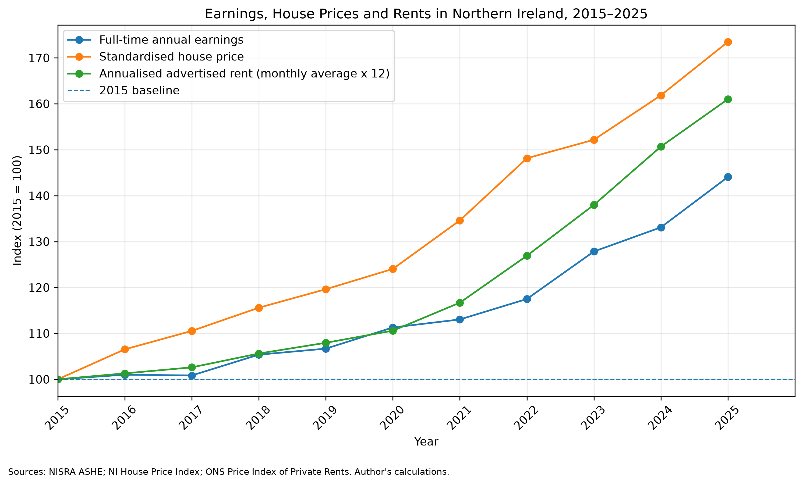
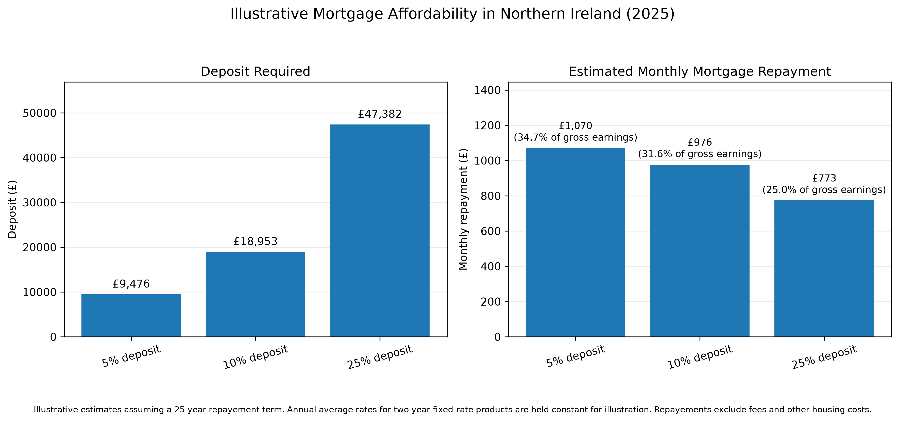

# The Cost of Financial Independence in Northern Ireland

## Overview

This project investigates how the financial barrier to independent living in Northern Ireland has changed over time, focusing on earnings, house prices, private rents and mortgage interest rates.

I used official UK and Northern Ireland datasets, and combined SQL based data management with Python analysis to examine changes in housing affordability from 2015 to 2025. I also developed mortgage repayment scenarios to investigate how deposit requirements and interest rates affect the cost of purchasing a home.

**Research question:** How has the financial barrier to independent living in Northern Ireland changed over time and how have earnings, housing costs and interest rates contributed to this change?

## Findings

Between 2015 and 2025:

- **Median full time annual earnings increased by 44.1%**, from £25,719 to £37,052.
- **Average house prices increased by 73.5%**, from £109,245 to £189,530.
- **Annualised advertised private rents increased by 61%**, from £6,410 to £10,321.
- The house-price-to-earnings ratio increased from 4.25 to 5.12, which shows the average property became more expensive compared to median full time annual earnings.
- Annualised advertised rent increased from 24.9% to 27.9% of median full time gross annual earnings.

These results show that house prices and advertised rents increased faster than median full time earnings from 2015-2025, suggesting that both buying and renting became more financially demanding relative to earnings.

### Mortgage Scenarios

Using 2025 house prices, annual earnings and average mortgage interest rates, I modelled three deposit scenarios for a 25 year repayment mortgage.

| Deposit | Deposit required | Estimated monthly repayment | Repayments as % of gross annual earnings |
|---|---:|---:|---:|
| 5% | £9,476 | £1,070 | 34.7% |
| 10% | £18,953 | £976 | 31.6% |
| 25% | £47,382 | £773 | 25.0% |

These scenarios show the trade-off between the savings required and the estimated monthly repayment. A larger deposit reduces the loan amount and, for this model, could also be associated with a lower mortgage interest rate.

## Visualisations

### Earnings, House Prices and Advertised Rents

The first figure indexes earnings, house prices and annualised advertised rents to 100 in 2015, allowing their growth to be compared over time. For example the median full time annual earnings were £25,719 in 2015 and £37,052 in 2025 so the earnings index for 2025 is approximately $37,052/25,719 * 100 = 144.1$.

### Illustrative Mortgage Affordability

The second figure compares the deposit required and estimated monthly repayments under three deposit scenarios using 2025 data.

## Data Sources

The project uses official statistical data from the following sources:

- **Northern Ireland Statistics and Research Agency (NISRA):** Annual Survey of Hours and Earnings (ASHE) headline time series, used for median annual earnings.
- **Northern Ireland House Price Index:** House price statistics, used to calculate annual average standardised property prices.
- **Office for National Statistics (ONS):** Price Index of Private Rents (PIPR), used to calculate annual average advertised monthly rents in Northern Ireland.
- **Bank of England:** Bank Rate and quoted mortgage interest-rate time series, including two year fixed rate products at different loan-to-value ratios.

The cleaned datasets are stored in `data/`. The SQL queries used to combine and analyse the data are stored in `sql/`.

## Methodology

### Data Preparation

The datasets were cleaned and made into consistent formats using python and pandas. Annual observations were made for earnings, house prices and rents while monthly observations were kept for Bank Rate and mortgage interest rates. The comparison covers the period 2015–2025. 

### SQL and Database Management

The cleaned datasets were loaded into a SQLite database. SQL was used to:

- Join earnings, house price and rent data by year.
- Calculate the house-price-to-earnings ratio.
- Calculate annualised advertised rent as a percentage of gross annual earnings.
- Turn monthly mortgage interest rates into yearly averages.
- Prepare the data used in the mortgage affordability analysis.

### Python Analysis

Python, pandas and Matplotlib were used to:

- Calculate percentage changes and compare how earnings, house prices and rents have changed since 2015.
- Calculate mortgage deposits and monthly repayments.
- Create figures to show the results.

The mortgage repayment model uses the standard mortgage repayment formula, assuming monthly repayments over a 25 year term: 
$$
M = P\frac{r(1+r)^n}{(1+r)^n-1}
$$

where:

- $M$ is the monthly repayment.
- $P$ is the mortgage loan amount.
- $r$ is the monthly interest rate (annual interest rate divided by 12).
- $n$ is the total number of monthly repayments (300 for a 25 year mortgage)

## Limitations

- **Nominal values:** Earnings, house prices and rents are not adjusted for inflation. The analysis compares changes in nominal values.
- **Advertised rents:** The ONS Northern Ireland rent series is advertised rents for newly let properties and may not represent the rents paid by all existing tenants.
- **Affordability measures:** Rent burden and mortgage repayment ratios use individual median full time gross earnings. They do not represent take home pay or household income and other living costs.
- **Mortgage assumptions:** The model uses annual average rates for two year fixed rate mortgage products and holds each rate constant over a 25 year repayment period. Actual rates and repayments may change.
- **Simplified scenarios:** The model does not include lender affordability assessments, mortgage fees, insurance, maintenance, taxes or other costs associated with buying a home.

## Tools and Technologies

- Python
- pandas
- SQLite
- SQL
- Matplotlib
- Git and GitHub

## Conclusion

From 2015 to 2025, house prices and advertised private rents in Northern Ireland rose substantially faster than median full-time annual earnings. The findings suggest that saving for a deposit and meeting ongoing housing costs became more challenging relative to earnings. The mortgage scenarios further illustrate how deposit size and interest rates can affect estimated monthly repayments. This analysis demonstrates how official economic data, SQL and Python can be used to investigate a real world financial question.
